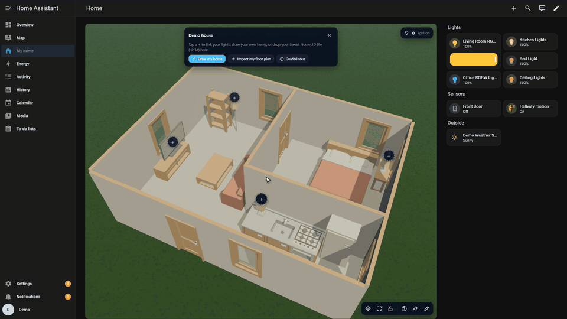
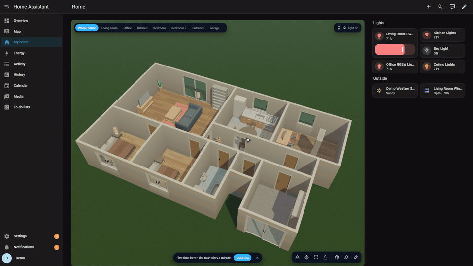
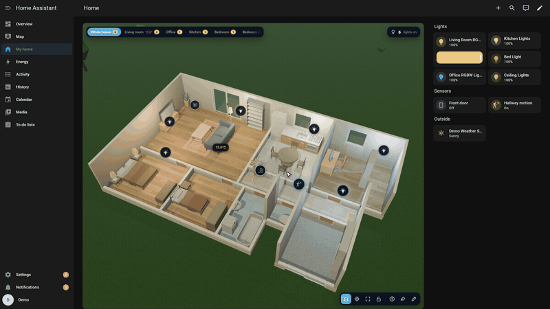
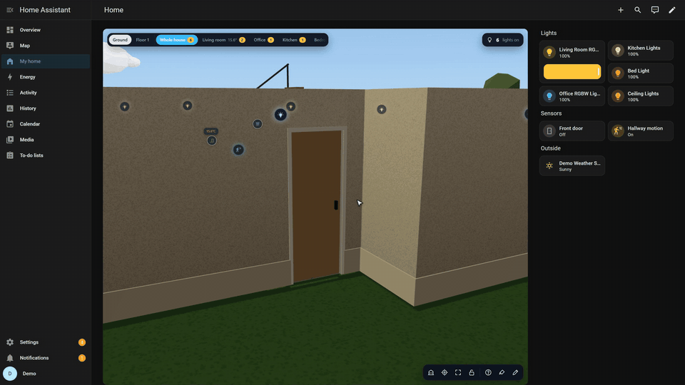
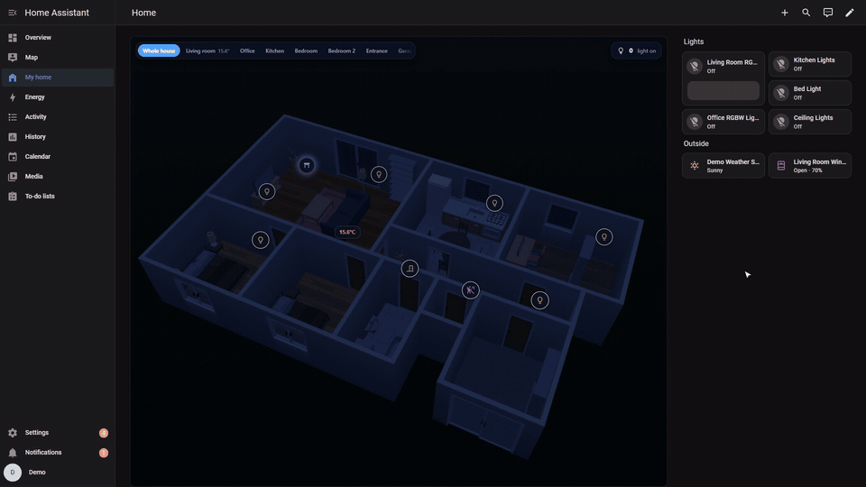
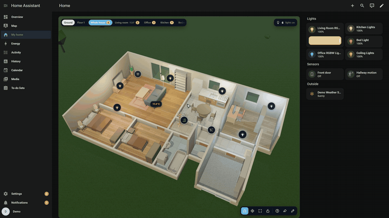

<div align="center">
  
  <h1>Houscape</h1>
  <p><strong>An interactive 3D home and visual floor-plan editor for Home Assistant.</strong></p>

  [](https://www.home-assistant.io/)
  [](https://hacs.xyz/)
  [](https://github.com/ProshkinM/houscape/actions/workflows/validate.yml)
  [](https://github.com/ProshkinM/houscape/actions/workflows/hassfest.yml)
  [](LICENSE)
</div>

<p align="center"><strong>English</strong> · <a href="README_RU.md">Русский</a></p>

Houscape turns a Home Assistant dashboard into a live 3D model of your home. Draw a floor plan directly in the browser or import an existing model, then connect lights, sensors, climate devices, doors, windows, cameras, and automations to real Home Assistant entities.

> [!IMPORTANT]
> Houscape is under active development. Back up your Home Assistant configuration and exported Houscape scenes before upgrading.

## Highlights

- Visual editor for rooms, walls, doors, windows, openings, floors, and stairs.
- Built-in catalogue with more than 200 pieces of furniture.
- Sweet Home 3D (`.sh3d`), GLB/GLTF, and OBJ imports.
- Entity markers with tap actions and Home Assistant more-info dialogs.
- Light colour and brightness synchronised with Home Assistant.
- Animated doors, windows, shutters, curtains, and model parts.
- Saved camera views with smooth transitions.
- No-code `when → if → then` rules.
- Sun position, weather, rain, and snow effects.
- Russian, English, and French interface languages.
- Local-first storage: scenes and models remain on your Home Assistant instance.

## Preview

| Floor-plan editor | Devices and live states |
|---|---|
|  |  |

<details>
<summary>More previews</summary>

| Multiple floors | Animated openings |
|---|---|
|  |  |

| Lighting | Rules and actions |
|---|---|
|  |  |

</details>

## Installation

Requires **Home Assistant 2024.1 or newer**. Houscape is installed as an integration and includes its Lovelace card; you do not need to add a separate dashboard resource.

### HACS (recommended)

[](https://my.home-assistant.io/redirect/hacs_repository/?owner=ProshkinM&repository=Houscape&category=integration)

[](https://my.home-assistant.io/redirect/config_flow_start/?domain=houscape)

1. Select the first button, confirm adding the custom repository, and choose **Download**.
2. Restart Home Assistant.
3. Select the second button and complete the integration setup.
4. Force-refresh the browser with `Ctrl+Shift+R` (`Cmd+Shift+R` on macOS).

<details>
<summary>Install with HACS without the buttons</summary>

1. Open **HACS → Integrations**.
2. Open the three-dot menu and choose **Custom repositories**.
3. Add `https://github.com/ProshkinM/Houscape` with category **Integration**.
4. Search for **Houscape**, select **Download**, and restart Home Assistant.
5. Open **Settings → Devices & services → Add integration**, search for **Houscape**, and complete the setup.

</details>

> [!NOTE]
> Choose the **Integration** category in HACS. The Lovelace card is bundled with the integration; there is no separate card download or resource URL to add.

### Manual installation

1. Download the source archive from the [latest release](https://github.com/ProshkinM/Houscape/releases/latest).
2. Copy `custom_components/houscape` to `<config>/custom_components/houscape`.
3. Restart Home Assistant.
4. Add **Houscape** from **Settings → Devices & services → Add integration**.
5. Force-refresh the browser after upgrading.

## Add the card

Add a **Manual** card to a Lovelace dashboard:

```yaml
type: custom:houscape-card
scene_id: main
height: 720px
```

Open the card and select the pencil button in the lower-right corner. You can then draw a home, choose a template, import a model, place devices, and configure rules without editing YAML.

For the complete editor reference, see the [user guide](docs/guide.md).

## Local demo

The demo uses a simulated Home Assistant instance, so no server or token is required.

```bash
git clone https://github.com/ProshkinM/houscape.git
cd houscape
npm ci
npm run dev
```

Open <http://127.0.0.1:4173/?lang=en>. Use `?lang=ru` or `?lang=fr` to open another language directly.

## Development

Requires Node.js 20 or newer.

```bash
npm ci
npm run typecheck
npm test
npm run build
npm run build:demo
```

The production card is written to `dist/houscape-card.js` and copied automatically to `custom_components/houscape/frontend/houscape-card.js`.

Repository layout:

- `src/` — 3D card and visual editor.
- `custom_components/houscape/` — Home Assistant integration and compiled frontend.
- `demo/` — standalone simulated Home Assistant demo.
- `docs/` — user guide and release notes.
- `assets/` — documentation media and branding.

Contributions and bug reports are welcome. Please read [CONTRIBUTING.md](CONTRIBUTING.md) before opening a pull request.

## Credits and license

Houscape is based on [Owlnest](https://github.com/MestrieEsteban/ha-owlnest) by Esteban Mestrie and is distributed under the MIT License. The original copyright notice is preserved in [LICENSE](LICENSE). Third-party packages and asset credits are listed in [THIRD_PARTY_NOTICES.md](THIRD_PARTY_NOTICES.md).

