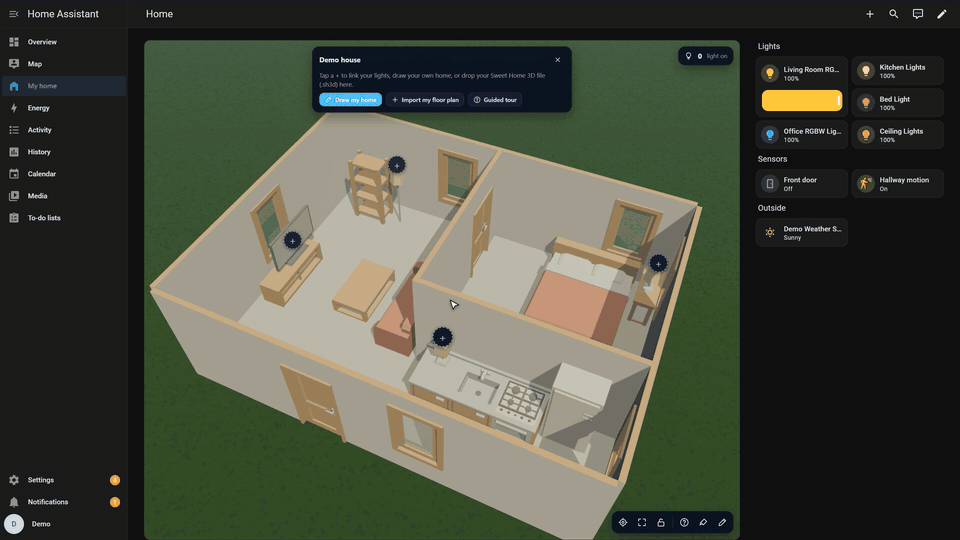
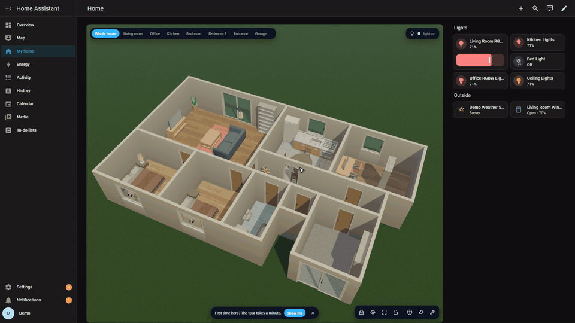

<div align="center">
  
  <h1>Houscape</h1>
  <p><strong>Интерактивный 3D-дом и визуальный редактор планировки для Home Assistant.</strong></p>

  [](https://www.home-assistant.io/)
  [](https://hacs.xyz/)
  [](https://github.com/ProshkinM/Houscape/actions/workflows/validate.yml)
  [](https://github.com/ProshkinM/Houscape/actions/workflows/hassfest.yml)
  [](LICENSE)
</div>

<p align="center"><a href="README.md">English</a> · <strong>Русский</strong></p>

Houscape превращает панель Home Assistant в живую 3D-модель дома. Нарисуйте планировку прямо в браузере или импортируйте готовую модель, после чего свяжите освещение, датчики, климат, двери, окна, камеры и правила с реальными сущностями Home Assistant.

> [!IMPORTANT]
> Проект активно развивается. Перед обновлением сохраняйте резервную копию конфигурации Home Assistant и экспортируйте важные сцены Houscape.

## Возможности

- Редактор комнат, стен, дверей, окон, проёмов, этажей и лестниц.
- Встроенный каталог из более чем 200 предметов мебели.
- Импорт Sweet Home 3D (`.sh3d`), GLB/GLTF и OBJ.
- Интерактивные устройства и стандартные окна подробностей Home Assistant.
- Синхронизация цвета и яркости 3D-светильников.
- Анимация дверей, окон, штор и других частей модели.
- Сохранённые камеры и плавные переходы.
- Визуальные правила «когда → если → тогда».
- Солнце, погода, дождь и снег.
- Русский, английский и французский интерфейсы.
- Локальное хранение сцен и моделей на вашем Home Assistant.

## Демонстрация

| Редактор планировки | Устройства и состояния |
|---|---|
|  |  |

[Открыть онлайн-демо](https://proshkinm.github.io/Houscape/?lang=ru)

## Установка

Требуется **Home Assistant 2024.1 или новее**. Houscape устанавливается как интеграция и уже содержит Lovelace-карточку. Отдельно добавлять ресурс карточки не требуется.

### Через HACS — рекомендуемый способ

[](https://my.home-assistant.io/redirect/hacs_repository/?owner=ProshkinM&repository=Houscape&category=integration)

[](https://my.home-assistant.io/redirect/config_flow_start/?domain=houscape)

1. Нажмите первую кнопку, подтвердите добавление пользовательского репозитория и выберите **Download**.
2. Перезапустите Home Assistant.
3. Нажмите вторую кнопку и подтвердите добавление интеграции.
4. Принудительно обновите страницу: `Ctrl+Shift+R` (`Cmd+Shift+R` в macOS).

<details>
<summary>Установка через HACS без кнопок</summary>

1. Откройте **HACS → Интеграции**.
2. В меню с тремя точками выберите **Пользовательские репозитории**.
3. Добавьте `https://github.com/ProshkinM/Houscape`, категория — **Integration**.
4. Найдите **Houscape**, нажмите **Download** и перезапустите Home Assistant.
5. Откройте **Настройки → Устройства и службы → Добавить интеграцию**, найдите **Houscape** и завершите настройку.

</details>

> [!NOTE]
> В HACS выбирайте категорию **Integration**. Карточка входит в состав интеграции — отдельная установка карточки или добавление URL в ресурсы Lovelace не нужны.

### Ручная установка

1. Скачайте архив исходного кода из [последнего релиза](https://github.com/ProshkinM/Houscape/releases/latest).
2. Скопируйте `custom_components/houscape` в `<config>/custom_components/houscape`.
3. Перезапустите Home Assistant.
4. Добавьте **Houscape** через **Настройки → Устройства и службы → Добавить интеграцию**.
5. После обновления принудительно перезагрузите страницу браузера.

## Добавление карточки

Добавьте на панель Lovelace карточку **Вручную**:

```yaml
type: custom:houscape-card
scene_id: main
height: 720px
```

Откройте карточку и нажмите кнопку с карандашом в правом нижнем углу. В редакторе можно нарисовать дом, выбрать шаблон, импортировать модель, расставить устройства и настроить правила без редактирования YAML.

## Локальная демонстрация и разработка

Потребуется Node.js 20 или новее.

```bash
git clone https://github.com/ProshkinM/Houscape.git
cd Houscape
npm ci
npm run dev
```

Откройте <http://127.0.0.1:4173/?lang=ru>.

Проверка проекта:

```bash
npm run typecheck
npm test
npm run build
npm run build:demo
```

## Лицензия и авторство

Houscape основан на проекте [Owlnest](https://github.com/MestrieEsteban/ha-owlnest) Эстебана Местри и распространяется по лицензии MIT. Исходное уведомление об авторских правах сохранено в [LICENSE](LICENSE), а сторонние зависимости и ресурсы перечислены в [THIRD_PARTY_NOTICES.md](THIRD_PARTY_NOTICES.md).

